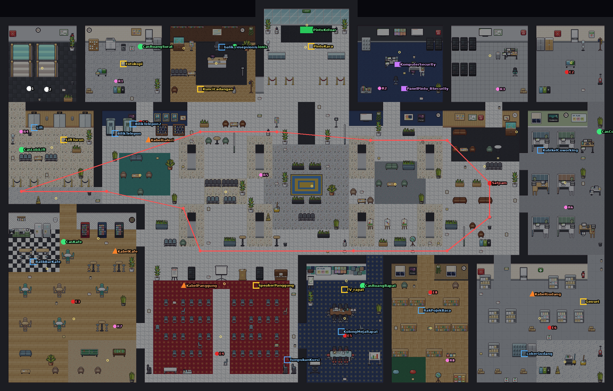

# Level 2 — Lobi Kantor "Gelap Gulita" (TileMap 72 × 46)

`scenes/level_2.tscn` adalah lobi kantor tempat pemain turun dari Level 1
lewat tangga darurat. Semua tile sudah dicat di `TileMapLayer`, jadi map
bisa diubah langsung pakai kuas TileMap di Godot.



- Desain gameplay lengkap (gambar yang disetujui): `desain_map_level2.png`
- Asal tiap aset di map: `sumber_aset_level2.png`
- Map polos tanpa penanda: `map_preview_level2.png`
- Isi atlas props (buat mencari tile saat mengecat): `katalog_props_lobi.png`

## Cara mencoba

1. Buka `scenes/level_2.tscn`, tekan **F6** (Run Current Scene). Game jalan
   dalam mode solo (bawaan NetworkManager).
2. Di panel **Output** harus muncul satu baris
   `[Level 2] tugas: 7 | tempat sembunyi: 10 | lampu: 30 | titik cas: 6 | titik kabel: 4 | titik rute satpam: 12`.
   Kalau ada angka 0, berarti ada node yang namanya berubah atau pindah.
3. Cek otomatis: buka `tests/smoke_test_level2.tscn`, tekan **F6**, lalu cari
   `SMOKE L2: ALL PASS` di Output.

Main menu masih membuka Level 1 saja; tombol Level 2 menyusul.

## Struktur scene

```
Level2 (Node2D, level_2.gd)
├── CanvasModulate
├── Lantai          (TileMapLayer, z -10)  lantai, tanpa collision
├── Dinding         (TileMapLayer, z -5)   wall top + wall face, ada collision
├── hiasan_dinding  (TileMapLayer, z -4)   poster, jam, papan, TV dinding (tanpa collision)
├── Props           (TileMapLayer, z 5)    furnitur, ada collision
├── Props2          (TileMapLayer, z 6)    barang kecil: kertas, kardus, gelas (tanpa collision)
├── NamaRuangan     (Label nama area, panduan editor, disembunyikan saat main)
├── Lampu           (30 PointLight2D, sebagian dikelompokkan per area)
│   ├── LampuTangga, PointLight2D, ExitSign, LayarCCTV, ...
│   ├── Resepsionis / Atrium / kafe / RuangRapat / Gudang   (Node2D berisi lampu)
├── Spawn
│   ├── PlayerSpawn1, PlayerSpawn2
│   ├── musuh       (EnemySpawn1–8)
│   └── Revive1–8
├── TitikCas        (6 Marker2D)   ← belum ada script
├── JalurSatpam     (Line2D Fase1, Fase2, Fase3; disembunyikan saat main)
├── Tugas           (7 TaskStation + Marker2D PanelPintu_RSecurity)
├── TempatSembunyi  (10 HidingSpot)
├── TitikKabel      (4 Marker2D)   ← belum ada script
├── PintuKeluar, Kurungan, ItemBangkit, Pemain
├── Satpam          (instance enemy.tscn)
├── KomputerSecurity (Marker2D)    ← belum ada script
└── HUD
```

### Nama yang tidak boleh diganti

`level_2.gd` mencari node berikut berdasarkan nama, jadi namanya jangan
diubah: `Lantai`, `Dinding`, `Props`, `CanvasModulate`, `Lampu`, `Spawn`,
`Tugas`, `TempatSembunyi`, `Pemain`, `Satpam`, `PintuKeluar`, `Kurungan`,
`ItemBangkit`, `HUD`, `NamaRuangan`, `JalurSatpam` (+ `Fase1` di dalamnya),
`TitikCas`, `TitikKabel`. Marker di dalam `Spawn` juga harus tetap bernama
`PlayerSpawn1`, `EnemySpawn1`, `Revive1`, dst.

Isi di **dalam** grup boleh bebas: nama lampu, nama tugas, nama tempat
sembunyi, dan folder Node2D tambahan (misal `Lampu/Atrium`) tidak masalah,
karena script mencarinya rekursif.

## TileSet: `assets/tiles/lobi/tileset_lobi.tres`

| Source | Gambar | Isi |
|---|---|---|
| 0 – dinding lobi | `dinding_lobi.png` | 37 potongan dinding gelap bubbabba (wall top + 2 baris wall face) |
| 1 – lantai | `lantai_lobi.png` | 23 jenis lantai (marmer, terrazzo, karpet, kayu, beton, dll) |
| 2 – props lobi | `props_lobi.png` | Furnitur & dekorasi dipotong per 32×32. Lihat `katalog_props_lobi.png` |

Semua tile dinding dan semua tile furnitur di source 2 punya collision
penuh 32×32, kecuali hiasan dinding dan barang kecil (tanpa collision).
Physics layer 0 = collision layer 1, sama seperti Level 1.

## Aturan waktu mengedit

1. **Satpam (pathfinding) membaca tile.** Cell bisa dilewati kalau ada tile
   di `Lantai` dan tidak ada tile di `Dinding` maupun `Props`. Barang yang
   boleh diinjak taruh di `Props2`, hiasan tembok di `hiasan_dinding`.
2. **Rute patroli Satpam** = titik-titik Line2D `JalurSatpam/Fase1`. Pilih
   node `Fase1`, lalu geser titiknya di viewport. Titik harus berada di
   lantai yang bisa dilewati. `Fase2` dan `Fase3` belum dipakai script.
3. **Tugas & tempat sembunyi** dihitung dari jarak: pemain harus bisa
   berdiri dalam 62 px dari tugas dan 50 px dari tempat sembunyi. Jangan
   taruh keduanya terlalu dekat (kalau dekat, tombol E selalu membuka tugas).
4. Setelah mengubah map, jalankan `tests/smoke_test_level2.tscn` (F6). Kalau
   jumlah tile berubah, angka di test ikut disesuaikan.

## Status mekanik

| Bagian | Status |
|---|---|
| Map, collision, lampu, tugas (minigame Level 1), sembunyi, kurungan, pintu keluar, bintang | Sudah jalan |
| Satpam | Sementara memakai AI musuh Level 1 (patroli + kejar + tangkap) di rute Fase1 |
| Baterai HP & titik cas, Mantan Bos, komputer security, error kabel, jam 21.00–05.00, Lari Subuh | Belum. Node penanda sudah ada (TitikCas, TitikKabel, KomputerSecurity, PanelPintu_RSecurity, JalurSatpam/Fase2–3) |
| Speaker panggung & lift | game_type sementara `email` dan `excel`; nanti diganti minigame tahan E dan keypad |

## Rumus posisi

posisi piksel = (kolom × 32 + 16, baris × 32 + 16) untuk tengah cell.
Ukuran map: 72 × 46 cell (2304 × 1472 px). Batas kamera diambil dari
`get_map_size_tiles()` di `level_2.gd`.

## Generator (arsip)

`tools/generate_tilemap_lobi.py` adalah script Python yang dulu dipakai
merakit map ini dari pack aslinya. Tidak perlu dijalankan; kalau dijalankan,
script itu menimpa `scenes/level_2.tscn` dan semua perubahan dari editor.
